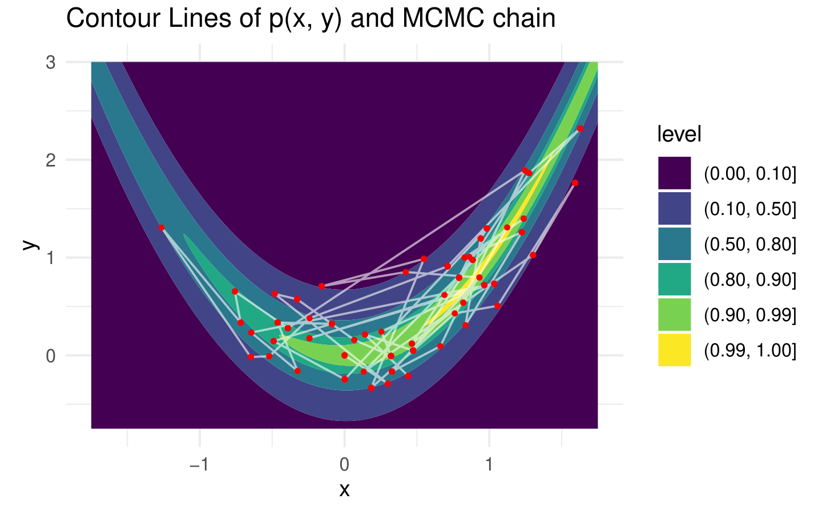
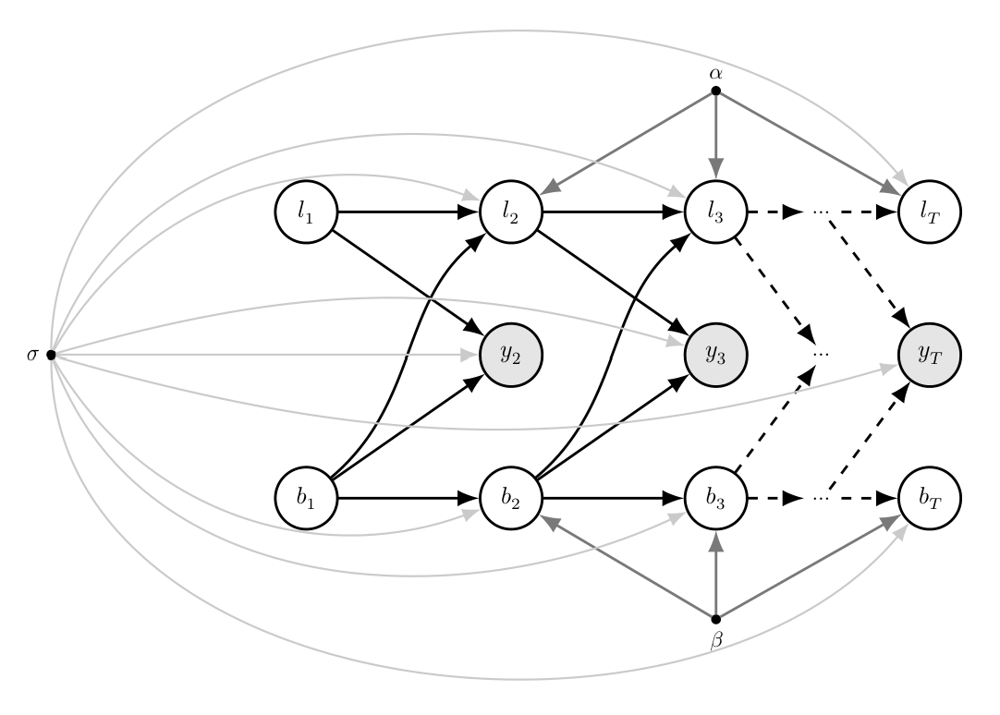

# Bayesian Inference & Decision Theory Workflow

Final project for the *Bayesian Modelling* course taught by Prof. Michael Höhle at the University of Greifswald (Summer Semester 2026). The complete mathematical derivation, diagnostics, and results are available in `hand-in.pdf`.

> **Status:** Archived university project — cleaned up for reference (uploaded with permission of Prof. Michael Höhle).

## Project Components

1. **Bayesian Time-Series Forecasting (`Holt.stan`):** Implements Holt's linear trend model in Stan to analyze and forecast Global Mean Sea Level (GMSL) data.
2. **Custom MCMC Sampling:** Implements and benchmarks a Markov Chain Monte Carlo sampler on a 2D Rosenbrock target distribution.
3. **Bayesian Decision Theory:** Formulates posterior loss minimization and optimal decision rules under uncertainty.

<p align="center">
  
    
  
  <br />
  <em><strong>Left:</strong> MCMC trajectory over probability density contours. <strong>Right:</strong> Directed acyclic graph (DAG) for Holt's linear model.</em>
</p>

## Repository Structure

- `hand-in.qmd` — Reproducible Quarto source document containing all R code, diagnostics, and narrative
- `hand-in.pdf` — Compiled final write-up
- `Holt.stan` — Stan model specification for Holt's linear trend model
- `project.pdf` — Original project specification

## Prerequisites

- **R:** 4.5.3+
- **Quarto:** 1.9.38
- **R Packages:** `cmdstanr` (0.9.0), `rstan` (2.32.7), `Rlgt` (0.2-3), `forecast` (9.0.2), `ggplot2` (4.0.3), `cubature` (2.1.4-1)

## Getting Started

1. Download the Global Mean Sea Level dataset from [CU Sea Level Research Group](https://sealevel.colorado.edu/) and save it as `data.txt` in the project root.
2. Render the full analysis and report via Quarto:
   ```bash
   quarto render hand-in.qmd
